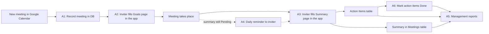

# Successful Meetings: Product Requirements Document

## Page 2: Solution and Architecture

Successful Meetings records every meeting in a database, captures its goals before it starts, requires the inviter to submit a summary with action items and deadlines afterwards, and tracks those action items until they are done. Management can query the database at any time.

### Solution overview

- Integration with **Google Calendar** first.
- A **web app built with Lovable** is where people fill in goals and summaries and close action items. It signs users in with their Google account and reads and writes the same Supabase database as the automations.
- Each meeting has a **goals and agenda document** and an **attendee list**.
- Meetings are **not recorded or transcribed**.
- After each meeting, the **inviter must fill in a meeting summary**: what was discussed and decided, plus the action items, each with an accountable person and a deadline.
- **Management** can see which meetings have a summary and pull reports from the database.

### Automations

| # | Automation | Trigger | What it does | Writes to |
| --- | --- | --- | --- | --- |
| A1 | Meeting registration | A new meeting is created in Google Calendar | Creates a record for the meeting | Meetings table |
| A2 | Goals collection | After A1 | Emails the inviter a link to the meeting's **Goals** page in the app. The page shows the meeting details and asks for the purpose of the meeting and the expected outcomes: answers, action items, timetable and so on. The inviter can add action items there. The meeting's page in the app is its summary document. | Goals fields and Summary document link in the Meetings table; Action Items table |
| A3 | Meeting summary collection | The meeting's end time passes | Emails the inviter a link to the meeting's **Summary** page in the app: what was discussed and decided, and the action items, each with an accountable person and a due date. The app saves the summary and creates the action items. | Summary document and Summary status in the Meetings table; Action Items table |
| A4 | Summary reminder | Daily | Sends a reminder to each inviter whose meeting summary is still Pending, until the summary is submitted in the app. | Read only |
| A5 | Management reports | On demand, by a manager | Runs the reports listed below | Read only |
| A6 | Action item closure | Daily | Sends a daily email to each accountable person who has open action items. Each item in the email links to the **My action items** page in the app, where it can be marked as Done. | Status in the Action Items table |

### Data model

**Meetings table**

| Column | Description |
| --- | --- |
| MeetingID | Unique ID, generated automatically |
| Meeting title | Title from the calendar invite |
| Scheduled date(s) | Date or dates of the meeting |
| Start time | When the meeting starts |
| End time | When the meeting ends |
| Duration | Length of the meeting, calculated from the start and end times |
| Inviter | The person who created the meeting |
| Attendees | People invited to the meeting |
| Summary document | Link to the meeting's page in the app (goals before the meeting, results after it) |
| Summary status | Pending until the inviter submits the summary in the app, then Submitted |

**Action Items table**

| Column | Description |
| --- | --- |
| MeetingID | The meeting the action item came from (links to the Meetings table) |
| Action item name | What needs to be done |
| Accountable | The person responsible |
| Due date | The date by which it must be done |
| Status | Open or Done. New items start as Open and are changed to Done by A6 |

### Web app (Lovable)

| Page | Who uses it | What it does |
| --- | --- | --- |
| Sign in | Everyone | Sign in with a Google account |
| My meetings | Inviter | Lists the meetings the user organized, with goals and summary status |
| Goals | Inviter | Purpose and expected outcomes before the meeting, plus action items known in advance |
| Summary | Inviter | What was discussed and decided after the meeting, plus action items with accountable person and due date |
| My action items | Accountable person | Lists the user's open action items; each can be marked as Done |

### Management reports (A5)

On demand, a manager can get:

1. The number of meetings held between two dates.
2. The number of working hours spent in meetings: each meeting's duration multiplied by its number of attendees.
3. The number of action items whose status is Open and whose due date has passed.
4. The meetings whose summary is still Pending.

**First release scope:** the organization is treated as flat, with one manager, so reports cover the whole organization. Reporting per team is planned for a later release (TBD).

### Flow

