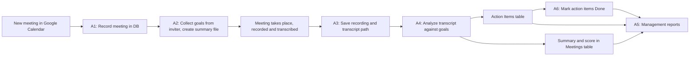

# Successful Meetings: Product Requirements Document

## Page 2: Solution and Architecture

Successful Meetings records every meeting in a database, captures its goals before it starts, checks the recording and transcript against those goals afterwards, and tracks the resulting action items. Management can query the database at any time.

### Solution overview

- Integration with **Google Calendar** first.
- Each meeting has a **goals and agenda document** and an **attendee list**.
- Meetings are **recorded and transcribed automatically** in **Zoom or Google Meet**.
- After each meeting, an automatic **summary** and a **success score from 1 to 100** are produced. The score reflects how fully the meeting goals were achieved and whether every attendee took part in the discussion.
- **Management** can see the scores and pull reports from the database.

### Automations

| # | Automation | Trigger | What it does | Writes to |
| --- | --- | --- | --- | --- |
| A1 | Meeting registration | A new meeting is created in Google Calendar | Creates a record for the meeting | Meetings table |
| A2 | Goals collection | After A1 | Sends the inviter a Google Form that shows the meeting details and asks for the purpose of the meeting and the expected outcomes: answers, action items, timetable and so on. The form has a place for the inviter to add more action items. Creates a summary file for the meeting. | Summary file; Summary field in the Meetings table; Action Items table |
| A3 | Recording capture | The meeting ends | Saves the location of the Zoom or Google Meet recording and transcript | Transcript path in the Meetings table |
| A4 | Meeting analysis | The transcript is available | Compares the recording and transcript with the goals from A2, checks whether the goals were achieved, gives the meeting a score from 1 to 100, and extracts clear action items, each with a due date | Action Items table; Summary and Score in the Meetings table |
| A5 | Management reports | On demand, by a manager | Runs the reports listed below | Read only |
| A6 | Action item closure | Daily | Sends a daily email to each accountable person who has open action items. Each item in the email has a link that marks it as Done. | Status in the Action Items table |

### Data model

**Meetings table**

| Column | Description |
| --- | --- |
| MeetingID | Unique ID, generated automatically |
| Meeting title | Title from the calendar invite |
| Scheduled date(s) | Date or dates of the meeting |
| Start time | When the meeting starts |
| End time | When the meeting ends |
| Duration | Length of the meeting, calculated from the start and end times |
| Inviter | The person who created the meeting |
| Attendees | People invited to the meeting |
| Summary document | The meeting's summary file (goals before the meeting, results after it) |
| Transcript path | Location of the recording and transcript |
| Score | Meeting success score from 1 to 100, set by A4 |

**Action Items table**

| Column | Description |
| --- | --- |
| MeetingID | The meeting the action item came from (links to the Meetings table) |
| Action item name | What needs to be done |
| Accountable | The person responsible |
| Due date | The date by which it must be done |
| Status | Open or Done. New items start as Open and are changed to Done by A6 |

### Management reports (A5)

On demand, a manager can get:

1. The number of meetings held between two dates.
2. The number of working hours spent in meetings: each meeting's duration multiplied by its number of attendees.
3. The number of action items whose status is Open and whose due date has passed.

**First release scope:** the organization is treated as flat, with one manager, so reports cover the whole organization. Reporting per team is planned for a later release (TBD).

### Flow

